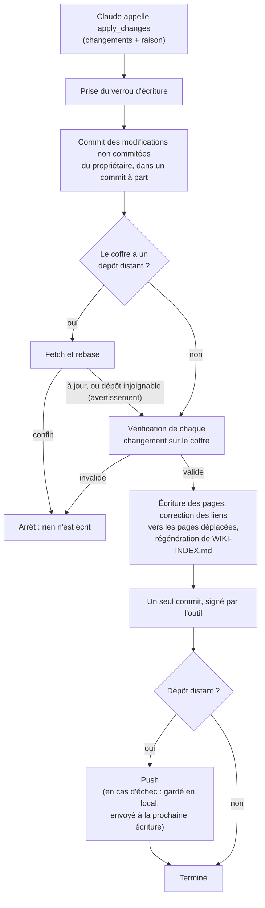
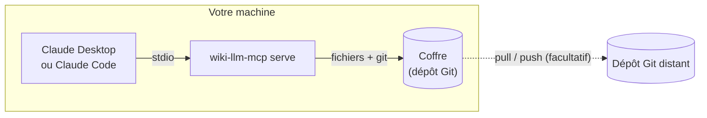
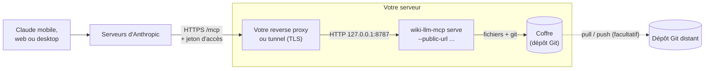
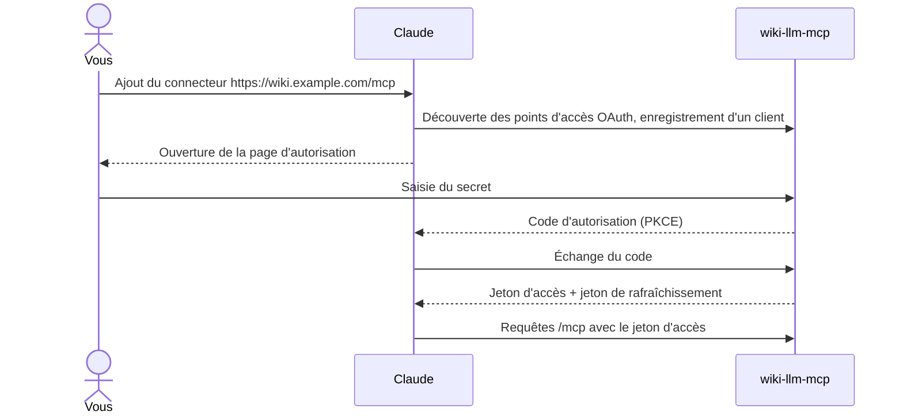

# wiki-llm-mcp

[English](README.md) · **Français**

Un serveur MCP qui permet à Claude de lire, chercher et maintenir votre coffre
(vault) Obsidian ou Markdown. Chaque changement est un commit Git, et rien ne
peut être supprimé par son intermédiaire sans votre accord.

> En début de développement : pas encore testé avec tous les clients Claude.

## Sommaire

- [Ce que ça fait](#ce-que-ça-fait)
  - [Comment un changement est écrit](#comment-un-changement-est-écrit)
- [Installation](#installation)
  - [Configurer avec un agent IA](#configurer-avec-un-agent-ia)
- [Utilisation](#utilisation)
- [Fichiers et suppression](#fichiers-et-suppression)
  - [Supprimer](#supprimer)
  - [Ajouter des fichiers](#ajouter-des-fichiers)
- [Mode distant (Claude mobile et web)](#mode-distant-claude-mobile-et-web)
  - [Avec Docker Compose](#avec-docker-compose)
  - [Sans Docker](#sans-docker)
  - [Connecter Claude](#connecter-claude)
  - [Changer le secret](#changer-le-secret)
- [Développement](#développement)
- [Licence](#licence)

## Ce que ça fait

- **Lire et chercher** dans les pages Markdown d'un coffre.
- **Créer, modifier et déplacer** des pages : remplacer un passage, ajouter à la
  fin, ou réécrire une page entière. Un appel produit un commit, ou n'écrit rien.
- **Ne jamais écraser une version plus récente** : réécrire une page entière
  exige la révision de la page telle qu'elle a été lue, et est refusé si la page
  a changé depuis (dans Obsidian, ou sur un autre appareil).
- **Garder les liens valides** quand une page est déplacée (`[[wikilinks]]` et
  liens Markdown). Les sources de `raw/` ne sont jamais réécrites : un lien
  qu'elles contiennent vers une page déplacée est signalé par un avertissement.
- **Protéger votre travail** : vos modifications non commitées sont enregistrées
  dans leur propre commit avant que le LLM n'écrive, et ses commits ont leur
  propre auteur.
- **Montrer ce qui a changé récemment**, d'après l'historique Git : quand,
  quelles pages, et si le changement vient de vous ou du LLM.
- **Synchroniser par Git** quand le coffre a un dépôt distant : pull avant
  d'écrire, push après. Une lecture récupère aussi ce que d'autres appareils
  ont poussé, au plus une fois par minute, et seulement si aucune fusion n'est
  nécessaire.
- **Servir un index à jour** : `WIKI-INDEX.md` est réécrit à chaque écriture, et
  sa lecture liste toujours les pages telles qu'elles sont maintenant, y compris
  celles ajoutées ou déplacées dans Obsidian depuis.

Par défaut, il n'y a ni outil de suppression ni moyen d'envoyer un fichier :
vous autorisez l'un et l'autre au démarrage du serveur, voir
[Fichiers et suppression](#fichiers-et-suppression). `.git`, `.obsidian` et les
fichiers cachés sont hors d'atteinte, comme tout ce qui se trouve en dehors du
coffre.

### Comment un changement est écrit

Chaque écriture suit les mêmes étapes, un seul écrivain à la fois. Si une étape
échoue avant le commit, les fichiers sont remis dans leur état d'origine.



## Installation

Il faut `git` sur la machine qui sert le coffre. Ensuite, au choix :

**L'extension Claude Desktop**, sur macOS et Windows : téléchargez
[`wiki-llm-mcp.mcpb`](https://github.com/tgalode/wiki-llm-mcp/releases/latest/download/wiki-llm-mcp.mcpb),
ouvrez-le avec Claude Desktop (ou déposez-le dans Réglages > Extensions), puis
choisissez votre dossier de notes. Rien d'autre à installer ni à configurer : le
dossier est préparé au premier démarrage.

**Un binaire précompilé**, pour Linux x86_64 (statique, toutes distributions),
macOS sur puce Apple, ou Windows x86_64
([`wiki-llm-mcp-x86_64-pc-windows-msvc.zip`](https://github.com/tgalode/wiki-llm-mcp/releases/latest/download/wiki-llm-mcp-x86_64-pc-windows-msvc.zip),
avec [Git pour Windows](https://git-scm.com/download/win) installé) :

```sh
target=x86_64-unknown-linux-musl   # macOS : aarch64-apple-darwin
curl -L "https://github.com/tgalode/wiki-llm-mcp/releases/latest/download/wiki-llm-mcp-$target.tar.gz" | tar -xz
sudo install wiki-llm-mcp /usr/local/bin/
wiki-llm-mcp --version
```

**Depuis les sources**, sur toute plateforme disposant d'une toolchain Rust :

```sh
cargo install --git https://github.com/tgalode/wiki-llm-mcp --locked
```

**L'image Docker**, `ghcr.io/tgalode/wiki-llm-mcp`, à lancer comme indiqué dans
[Mode distant](#mode-distant-claude-mobile-et-web).

Suivez ensuite [Utilisation](#utilisation), ou laissez un agent le faire pour vous.

### Configurer avec un agent IA

Collez ce texte dans un agent de code (Claude Code ou équivalent) qui tourne sur
la machine où se trouve votre coffre :

```text
Installe et configure wiki-llm-mcp pour moi : un serveur MCP qui permet à
Claude de lire, chercher et maintenir un coffre Markdown/Obsidian, en commitant
chaque changement dans Git.
Sources et documentation : https://github.com/tgalode/wiki-llm-mcp (lis d'abord
son README, README.fr.md en français ; il fait référence pour toutes les
commandes ci-dessous).

Avant de faire quoi que ce soit, demande-moi :
1. Le chemin du coffre : un dossier de notes existant, ou un nouveau dossier à
   créer.
2. Si je veux seulement le mode local (Claude Desktop / Claude Code sur cette
   machine) ou aussi le mode distant (Claude mobile et web, qui demande une
   adresse HTTPS publique que je dois fournir avec un reverse proxy ou un
   tunnel).

Ensuite :
1. Vérifie que git est installé. Installe le binaire comme le décrit la
   section Installation du README : le binaire précompilé s'il existe pour
   cette plateforme, sinon `cargo install`, ou l'image Docker. N'installe ni
   toolchain ni paquet système sans me demander.
2. Lance `wiki-llm-mcp init <coffre>`. La commande laisse mes notes existantes
   à leur place et commite d'abord leur état d'origine. Si elle refuse (le
   dossier est dans un autre dépôt Git, ou il existe déjà un WIKI-INDEX.md
   qu'elle n'a pas généré), arrête-toi et explique-moi pourquoi : ne déplace,
   ne renomme et ne supprime rien pour contourner le refus.
3. Mode local : déclare le serveur dans mon client MCP avec la commande
   `wiki-llm-mcp serve <chemin absolu du coffre>`, en chemins absolus (Claude
   Desktop : `claude_desktop_config.json` ; Claude Code :
   `claude mcp add wiki -- <binaire> serve <coffre>`).
4. Mode distant, seulement si je l'ai demandé : démarre le serveur comme le
   décrit la section Mode distant du README (Docker Compose si Docker est
   présent, sinon le binaire avec `--public-url`). Il génère lui-même son
   secret : donne-moi la commande qui l'affiche, et n'affiche jamais le secret
   dans la conversation ni dans un commit.
   N'expose rien publiquement toi-même : dis-moi vers quelle adresse et quel
   port mon proxy ou mon tunnel doit pointer, puis donne-moi l'URL du
   connecteur (`<url publique>/mcp`) à ajouter dans Claude.
5. Vérifie : `wiki-llm-mcp --version` fonctionne, le `git log` du coffre montre
   le commit de mise en place, et le serveur démarre sans erreur.

Ne modifie et ne supprime jamais mes notes pendant l'installation. Termine en
me disant ce que tu as installé et où, comment le serveur est lancé, où le
secret est rangé (s'il y en a un), et que le fichier WIKI.md du coffre contient
les règles que Claude suit, que je peux modifier.
```

## Utilisation

```sh
wiki-llm-mcp init ./vault    # dossier vide ou coffre existant
wiki-llm-mcp serve ./vault   # le sert sur stdio
```

`init` ajoute `raw/`, `wiki/`, `WIKI.md` et un `WIKI-INDEX.md` généré, et met en
place Git. Les notes existantes restent où elles sont ; leur état d'origine est
commité en premier. `serve --init` le fait au premier démarrage, si le dossier
n'est pas encore prêt.

`WIKI.md` contient les règles données au LLM quand il se connecte. Modifiez-le
pour changer la façon dont votre wiki est maintenu. Le LLM ne peut pas le
modifier.

Dans ce mode, tout tourne sur votre machine : le client lance lui-même le
serveur et lui parle sur stdio. Aucun port n'est ouvert et aucun secret n'est
nécessaire.



Pour Claude Desktop, dans `claude_desktop_config.json` :

```json
{
  "mcpServers": {
    "wiki": {
      "command": "/chemin/vers/wiki-llm-mcp",
      "args": ["serve", "/chemin/vers/le/coffre"]
    }
  }
}
```

## Fichiers et suppression

Les fichiers qui ne sont pas des pages Markdown (PDF, images, pièces jointes)
peuvent toujours être listés, avec leur taille. Leur contenu n'est pas lisible
par le serveur. La suppression et l'ajout de ces fichiers sont désactivés tant
que vous ne les autorisez pas.

### Supprimer

```sh
wiki-llm-mcp serve ./vault --allow-delete
```

Claude dispose alors d'un outil `delete`, distinct de celui qui modifie les
pages : votre client peut ainsi demander votre accord pour les seules
suppressions. Il supprime des pages et des fichiers, tous ou aucun, en un
commit :

- Git garde ce qui a été supprimé : `git revert <commit>` le fait revenir.
- Les liens qui menaient à une page ou à un fichier supprimé ne sont pas
  retirés. Ils sont signalés, pour que Claude les corrige ou vous demande.
- `WIKI.md` et `WIKI-INDEX.md` ne peuvent pas être supprimés.

Les règles par défaut de `WIKI.md` demandent à Claude de ne supprimer que si
vous le lui demandez. Un coffre préparé avec une version antérieure contient
« Never delete a note » : modifiez cette ligne, sinon Claude continuera de
refuser.

### Ajouter des fichiers

Les octets d'un fichier ne peuvent pas passer par un appel MCP. En mode
distant, le serveur peut à la place fournir des liens d'envoi :

```sh
wiki-llm-mcp serve ./vault --public-url https://wiki.example.com --allow-upload
```

Demandez à Claude un lien pour ajouter des fichiers. L'outil `upload_link`
renvoie une adresse comme `https://wiki.example.com/upload/<jeton>` : ouvrez-la
dans un navigateur, choisissez les fichiers, renommez-les au besoin, envoyez.
Chaque fichier est commité et poussé, dans un commit qui n'est pas signé par le
LLM.

- Un lien fonctionne 30 minutes, pour un dossier (`raw/`, sauf si Claude en
  demande un autre) et pour 50 fichiers. Redémarrer le serveur ferme tous les
  liens.
- Un fichier ne remplace jamais un fichier existant, et ne dépasse pas 25 Mo.
- Le lien est le seul moyen d'authentification : quiconque le détient peut
  ajouter des fichiers tant qu'il est valide, mais ne peut rien lire ni
  modifier. Traitez-le comme un mot de passe.
- Un script peut aussi envoyer un fichier :
  `curl -T scan.pdf https://wiki.example.com/upload/<jeton>/scan.pdf`

En stdio, le coffre est un dossier de votre machine : copiez-y les fichiers.

## Mode distant (Claude mobile et web)

Les applications Claude joignent les connecteurs depuis les serveurs
d'Anthropic : le coffre doit donc être servi à une adresse HTTPS publique. C'est
à vous de fournir cette adresse avec un reverse proxy ou un tunnel ; TLS n'est
pas géré ici.



### Avec Docker Compose

```sh
mkdir wiki-llm-mcp && cd wiki-llm-mcp
curl -LO https://raw.githubusercontent.com/tgalode/wiki-llm-mcp/main/deploy/compose.yaml
curl -L -o .env https://raw.githubusercontent.com/tgalode/wiki-llm-mcp/main/deploy/.env.example
nano .env                 # renseigner PUBLIC_URL
mkdir -p vault            # ou pointer VAULT vers vos notes existantes
docker compose up -d
docker compose exec wiki wiki-llm-mcp secret /vault
```

Le premier démarrage prépare le coffre et génère le secret ; la dernière
commande l'affiche. Pointez votre reverse proxy vers `127.0.0.1:8787`.

Sans reverse proxy, le même fichier peut lancer un
[tunnel Cloudflare](https://developers.cloudflare.com/cloudflare-one/connections/connect-networks/) :
renseignez `TUNNEL_TOKEN` dans `.env`, donnez au nom d'hôte public du tunnel le
service `http://wiki:8787`, puis démarrez avec
`docker compose --profile tunnel up -d`. Aucun port n'est à ouvrir sur le
serveur.

Pour construire l'image vous-même : `docker build -t wiki-llm-mcp .`

### Sans Docker

```sh
wiki-llm-mcp serve ./vault --init --public-url https://wiki.example.com
wiki-llm-mcp secret ./vault    # affiche le secret généré au premier démarrage
```

Le serveur écoute sur `127.0.0.1:8787` (`--bind` pour changer) : pointez votre
reverse proxy ou votre tunnel dessus.

Pour choisir vous-même le secret, définissez la variable d'environnement
`WIKI_LLM_MCP_SECRET`. Elle a la priorité, et rien n'est stocké.

### Connecter Claude

Dans Claude,
ajoutez un connecteur personnalisé avec l'URL `https://wiki.example.com/mcp`,
choisissez l'enregistrement automatique du client OAuth (**Register
automatically**), puis saisissez le secret sur la page qui s'ouvre.

Le secret est saisi une seule fois, dans votre navigateur, et n'arrive jamais
jusqu'à Claude :



- Le secret généré est stocké dans `.git/wiki-llm-mcp/secret`, lisible par son
  seul propriétaire et hors des fichiers du coffre. Un secret fourni par
  `WIKI_LLM_MCP_SECRET` doit faire au moins 20 caractères. Sous Windows, ce
  fichier et les jetons ne sont protégés que par les permissions du dossier.
- Seules l'adresse de retour de Claude et les adresses locales peuvent recevoir
  une autorisation. `--allow-redirect-uri` permet d'autoriser un autre client.
- Les jetons sont stockés hachés dans `.git/wiki-llm-mcp/`, jamais dans les
  fichiers du coffre.
- `wiki-llm-mcp revoke ./vault` déconnecte tous les clients immédiatement. La
  commande ne change pas le secret.
- Après 10 échecs de connexion en 15 minutes, les nouvelles connexions sont
  bloquées jusqu'à la fin de cette fenêtre. Les clients déjà connectés
  continuent de fonctionner.

### Changer le secret

Le secret n'est que le mot de passe demandé sur la page d'autorisation. Les
jetons sont aléatoires et n'en dépendent pas : il y a donc deux actions
distinctes.

1. **Changer le secret** : `wiki-llm-mcp secret ./vault --new` en génère un
   nouveau et l'affiche (ou mettez une nouvelle valeur dans
   `WIKI_LLM_MCP_SECRET` si vous l'utilisez), puis redémarrez le serveur. Les
   clients déjà connectés continuent de fonctionner ; le nouveau secret sera
   demandé à la prochaine connexion d'un client.
2. **Révoquer les sessions** : `wiki-llm-mcp revoke ./vault`. Chaque client doit
   alors se reconnecter, avec le secret en vigueur.

Pour un changement de routine, la première suffit. Si le secret a pu fuiter,
faites les deux, dans cet ordre : quelqu'un a pu obtenir des jetons avec
l'ancien.

## Développement

`./dev.sh test` lance cargo dans un conteneur : seul Docker est nécessaire.

## Licence

MIT
