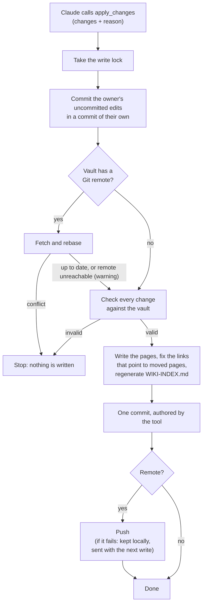
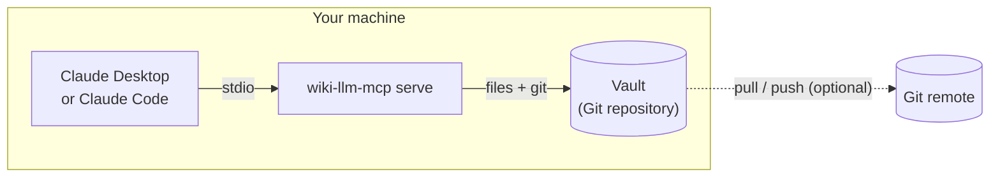
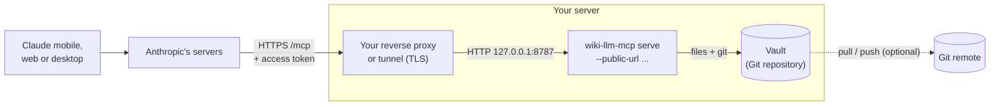
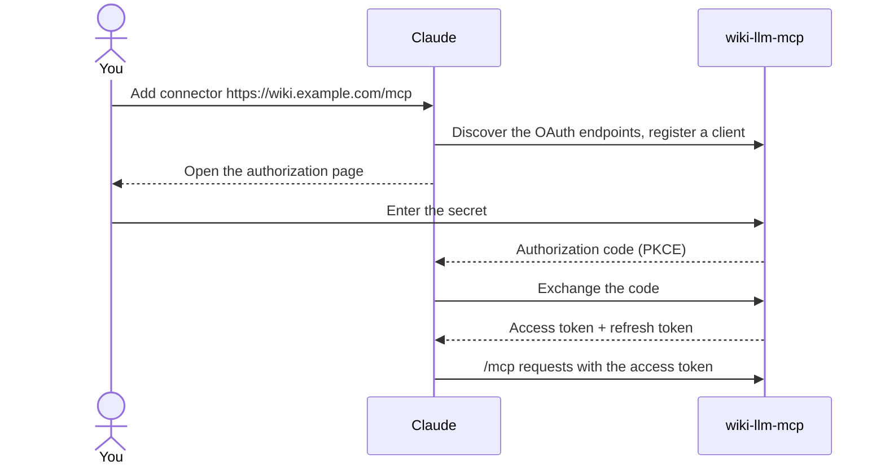

# wiki-llm-mcp

**English** · [Français](README.fr.md)

An MCP server that lets Claude read, search and maintain your Obsidian or
Markdown vault. Every change is a Git commit, and notes can never be deleted
through it.

> Early development: not yet tested against every Claude client.

## Contents

- [What it does](#what-it-does)
  - [How a change is written](#how-a-change-is-written)
- [Install](#install)
  - [Set up with an AI agent](#set-up-with-an-ai-agent)
- [Usage](#usage)
- [Remote mode (Claude mobile and web)](#remote-mode-claude-mobile-and-web)
  - [With Docker Compose](#with-docker-compose)
  - [Without Docker](#without-docker)
  - [Connecting Claude](#connecting-claude)
  - [Rotating the secret](#rotating-the-secret)
- [Development](#development)
- [License](#license)

## What it does

- **Read and search** the Markdown pages of a vault.
- **Create, edit and move** pages: replace one passage, add at the end, or
  rewrite a whole page. One call makes one commit, or writes nothing.
- **Never overwrite a newer version**: rewriting a whole page requires the
  revision of the page as it was read, and is refused if the page changed since
  (in Obsidian, or on another device).
- **Keep links valid** when a page moves (`[[wikilinks]]` and Markdown links).
- **Protect your work**: uncommitted edits are saved in their own commit before
  the LLM writes, and its commits have their own author.
- **Sync through Git** when the vault has a remote: pull before writing, push after.

There is no delete tool. `.git`, `.obsidian` and hidden files are out of reach,
as is anything outside the vault.

### How a change is written

Every write goes through the same steps, one writer at a time. If any step
before the commit fails, the files are put back as they were.



## Install

You need `git` on the machine that serves the vault. Then pick one of:

**A prebuilt binary**, for Linux x86_64 (static, any distribution) or macOS on
Apple silicon:

```sh
target=x86_64-unknown-linux-musl   # macOS: aarch64-apple-darwin
curl -L "https://github.com/tgalode/wiki-llm-mcp/releases/latest/download/wiki-llm-mcp-$target.tar.gz" | tar -xz
sudo install wiki-llm-mcp /usr/local/bin/
wiki-llm-mcp --version
```

**From source**, on any platform with a Rust toolchain:

```sh
cargo install --git https://github.com/tgalode/wiki-llm-mcp --locked
```

**The Docker image**, `ghcr.io/tgalode/wiki-llm-mcp`, used as shown under
[Remote mode](#remote-mode-claude-mobile-and-web).

Then follow [Usage](#usage), or let an agent do it for you.

### Set up with an AI agent

Paste this into a coding agent (Claude Code or similar) running on the machine
that holds your vault:

```text
Set up wiki-llm-mcp for me: an MCP server that lets Claude read, search and
maintain a Markdown/Obsidian vault, committing every change to Git.
Source and documentation: https://github.com/tgalode/wiki-llm-mcp (read its
README first; it is the reference for every command below).

Before doing anything, ask me:
1. The path of the vault: an existing folder of notes, or a new folder to create.
2. Whether I want local mode only (Claude Desktop / Claude Code on this
   machine) or also remote mode (Claude mobile and web, which needs a public
   HTTPS address that I must provide through a reverse proxy or a tunnel).

Then:
1. Check that git is installed. Install the binary the way the README's
   Install section describes: the prebuilt binary if there is one for this
   platform, otherwise `cargo install`, or the Docker image. Do not install a
   toolchain or any system package without asking me.
2. Run `wiki-llm-mcp init <vault>`. It keeps my existing notes where they are
   and commits their original state first. If it refuses (the folder is inside
   another Git repository, or a WIKI-INDEX.md it did not generate already
   exists), stop and tell me why: do not move, rename or delete anything to get
   around it.
3. Local mode: register the server in my MCP client with the command
   `wiki-llm-mcp serve <absolute vault path>`, using absolute paths (Claude
   Desktop: `claude_desktop_config.json`; Claude Code:
   `claude mcp add wiki -- <binary> serve <vault>`).
4. Remote mode, only if I asked for it: start the server as the README's
   Remote mode section describes (Docker Compose if Docker is there, the
   binary with `--public-url` otherwise). It generates its own secret: tell me
   the command that displays it, and never print the secret in the
   conversation or commit it. Do not expose anything publicly
   yourself: tell me which address and port my proxy or tunnel must point to,
   then give me the connector URL (`<public url>/mcp`) to add in Claude.
5. Verify: `wiki-llm-mcp --version` works, the vault's `git log` shows the
   setup commit, and the server starts without error.

Never edit or delete my notes during setup. Finish by telling me what you
installed and where, how the server is started, where the secret is kept (if
any), and that WIKI.md in the vault holds the rules Claude follows, which I can
edit.
```

## Usage

```sh
wiki-llm-mcp init ./vault    # empty folder or existing vault
wiki-llm-mcp serve ./vault   # serve it over stdio
```

`init` adds `raw/`, `wiki/`, `WIKI.md` and a generated `WIKI-INDEX.md`, and sets
up Git. Existing notes stay where they are; their original state is committed first.
`serve --init` does it on the first start, if the folder is not ready yet.

`WIKI.md` holds the rules given to the LLM when it connects. Edit it to change
how your wiki is maintained. The LLM cannot modify it.

In this mode everything runs on your machine: the client starts the server
itself and talks to it over stdio. No port is opened and no secret is needed.



For Claude Desktop, in `claude_desktop_config.json`:

```json
{
  "mcpServers": {
    "wiki": {
      "command": "/path/to/wiki-llm-mcp",
      "args": ["serve", "/path/to/vault"]
    }
  }
}
```

## Remote mode (Claude mobile and web)

Claude's apps reach connectors from Anthropic's servers, so the vault must be
served at a public HTTPS address. You provide that address with a reverse proxy
or a tunnel; TLS is not handled here.



### With Docker Compose

```sh
mkdir wiki-llm-mcp && cd wiki-llm-mcp
curl -LO https://raw.githubusercontent.com/tgalode/wiki-llm-mcp/main/deploy/compose.yaml
curl -L -o .env https://raw.githubusercontent.com/tgalode/wiki-llm-mcp/main/deploy/.env.example
nano .env                 # set PUBLIC_URL
mkdir -p vault            # or set VAULT to your existing notes
docker compose up -d
docker compose exec wiki wiki-llm-mcp secret /vault
```

The first start prepares the vault and generates the secret; the last command
prints it. Point your reverse proxy at `127.0.0.1:8787`.

Without a reverse proxy, the same file can run a
[Cloudflare Tunnel](https://developers.cloudflare.com/cloudflare-one/connections/connect-networks/):
set `TUNNEL_TOKEN` in `.env`, give the tunnel's public hostname the service
`http://wiki:8787`, and start with `docker compose --profile tunnel up -d`. No
port has to be opened on the server.

To build the image yourself: `docker build -t wiki-llm-mcp .`

### Without Docker

```sh
wiki-llm-mcp serve ./vault --init --public-url https://wiki.example.com
wiki-llm-mcp secret ./vault    # prints the secret generated on the first start
```

The server listens on `127.0.0.1:8787` (`--bind` to change it): point your
reverse proxy or tunnel at it.

To choose the secret yourself, set the `WIKI_LLM_MCP_SECRET` environment
variable. It takes precedence, and nothing is stored.

### Connecting Claude

In Claude, add a custom connector with the URL `https://wiki.example.com/mcp`,
choose **Register automatically** for the OAuth client, and enter the secret on
the page that opens.

The secret is typed once, in your browser, and never reaches Claude:



- The generated secret is stored in `.git/wiki-llm-mcp/secret`, readable by its
  owner only and outside the vault's files. A secret set through
  `WIKI_LLM_MCP_SECRET` must be at least 20 characters long.
- Only Claude's callback and local addresses can receive an authorization. Use
  `--allow-redirect-uri` to allow another client.
- Tokens are stored hashed inside `.git/wiki-llm-mcp/`, never in the vault's files.
- `wiki-llm-mcp revoke ./vault` disconnects every client immediately. It does
  not change the secret.
- After 10 failed logins in 15 minutes, new logins are blocked for the rest of
  that window. Clients already connected keep working.

### Rotating the secret

The secret is only the password asked on the authorization page. Tokens are
random and do not depend on it, so there are two separate actions:

1. **Change the secret**: `wiki-llm-mcp secret ./vault --new` generates and
   prints a new one (or set a new value in `WIKI_LLM_MCP_SECRET` if you use
   it), then restart the server. Clients already connected keep working; the
   new secret is asked the next time a client connects.
2. **Revoke the sessions**: `wiki-llm-mcp revoke ./vault`. Every client must
   then connect again, with the current secret.

For a routine rotation, the first is enough. If the secret may have leaked, do
both, in that order: someone could have obtained tokens with the old one.

## Development

`./dev.sh test` runs cargo in a container: only Docker is required.

## License

MIT
