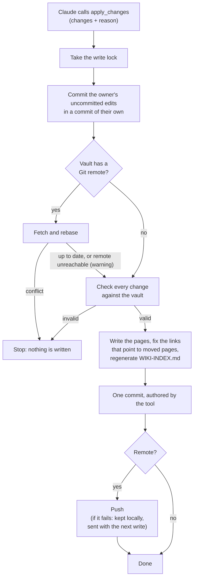
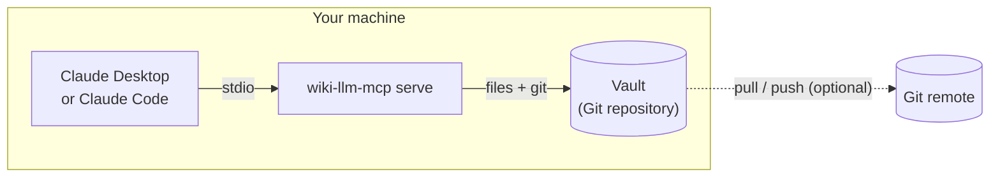
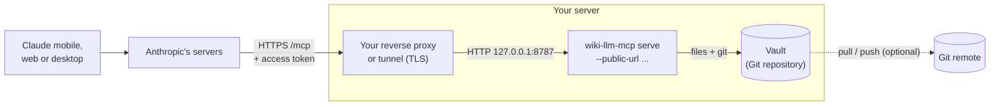
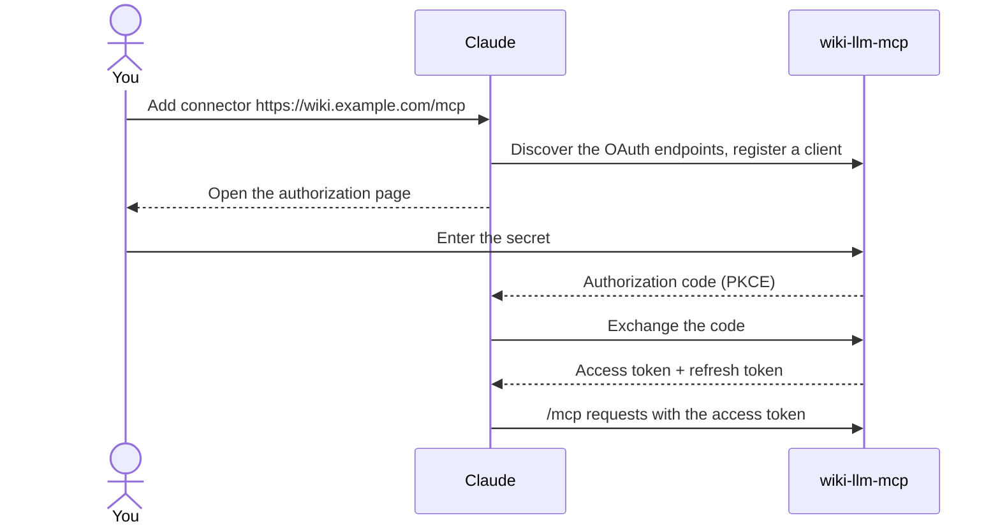

# wiki-llm-mcp

**English** · [Français](README.fr.md)

An MCP server that lets Claude read, search and maintain your Obsidian or
Markdown vault. Every change is a Git commit, and notes can never be deleted
through it.

> Early development: not yet tested against every Claude client.

## Contents

- [What it does](#what-it-does)
  - [How a change is written](#how-a-change-is-written)
- [Install](#install)
  - [Set up with an AI agent](#set-up-with-an-ai-agent)
- [Usage](#usage)
- [Remote mode (Claude mobile and web)](#remote-mode-claude-mobile-and-web)
  - [Rotating the secret](#rotating-the-secret)
- [Development](#development)
- [License](#license)

## What it does

- **Read and search** the Markdown pages of a vault.
- **Create, update and move** pages. One call makes one commit, or writes nothing.
- **Keep links valid** when a page moves (`[[wikilinks]]` and Markdown links).
- **Protect your work**: uncommitted edits are saved in their own commit before
  the LLM writes, and its commits have their own author.
- **Sync through Git** when the vault has a remote: pull before writing, push after.

There is no delete tool. `.git`, `.obsidian` and hidden files are out of reach,
as is anything outside the vault.

### How a change is written

Every write goes through the same steps, one writer at a time. If any step
before the commit fails, the files are put back as they were.



## Install

You need `git` on the machine that serves the vault, and either a Rust
toolchain or Docker to build.

```sh
git clone https://github.com/tgalode/wiki-llm-mcp
cd wiki-llm-mcp
cargo install --path . --locked   # installs ~/.cargo/bin/wiki-llm-mcp
wiki-llm-mcp --version
```

Without Rust, build the image instead (`docker build -t wiki-llm-mcp .`) and
run it as shown under [Remote mode](#remote-mode-claude-mobile-and-web).

Then follow [Usage](#usage), or let an agent do it for you.

### Set up with an AI agent

Paste this into a coding agent (Claude Code or similar) running on the machine
that holds your vault:

```text
Set up wiki-llm-mcp for me: an MCP server that lets Claude read, search and
maintain a Markdown/Obsidian vault, committing every change to Git.
Source and documentation: https://github.com/tgalode/wiki-llm-mcp (read its
README first; it is the reference for every command below).

Before doing anything, ask me:
1. The path of the vault: an existing folder of notes, or a new folder to create.
2. Whether I want local mode only (Claude Desktop / Claude Code on this
   machine) or also remote mode (Claude mobile and web, which needs a public
   HTTPS address that I must provide through a reverse proxy or a tunnel).

Then:
1. Check that git is installed. Build the binary with
   `cargo install --path . --locked` from a clone of the repository, or build
   the Docker image if there is no Rust toolchain. Do not install a toolchain
   or any system package without asking me.
2. Run `wiki-llm-mcp init <vault>`. It keeps my existing notes where they are
   and commits their original state first. If it refuses (the folder is inside
   another Git repository, or a WIKI-INDEX.md it did not generate already
   exists), stop and tell me why: do not move, rename or delete anything to get
   around it.
3. Local mode: register the server in my MCP client with the command
   `wiki-llm-mcp serve <absolute vault path>`, using absolute paths (Claude
   Desktop: `claude_desktop_config.json`; Claude Code:
   `claude mcp add wiki -- <binary> serve <vault>`).
4. Remote mode, only if I asked for it: generate a secret with
   `openssl rand -base64 32`, store it in a file only I can read, never print
   it in the conversation or commit it, and start the server with
   `--public-url` as the README describes. Do not expose anything publicly
   yourself: tell me which address and port my proxy or tunnel must point to,
   then give me the connector URL (`<public url>/mcp`) to add in Claude.
5. Verify: `wiki-llm-mcp --version` works, the vault's `git log` shows the
   setup commit, and the server starts without error.

Never edit or delete my notes during setup. Finish by telling me what you
installed and where, how the server is started, where the secret is kept (if
any), and that WIKI.md in the vault holds the rules Claude follows, which I can
edit.
```

## Usage

```sh
wiki-llm-mcp init ./vault    # empty folder or existing vault
wiki-llm-mcp serve ./vault   # serve it over stdio
```

`init` adds `raw/`, `wiki/`, `WIKI.md` and a generated `WIKI-INDEX.md`, and sets
up Git. Existing notes stay where they are; their original state is committed first.

`WIKI.md` holds the rules given to the LLM when it connects. Edit it to change
how your wiki is maintained. The LLM cannot modify it.

In this mode everything runs on your machine: the client starts the server
itself and talks to it over stdio. No port is opened and no secret is needed.



For Claude Desktop, in `claude_desktop_config.json`:

```json
{
  "mcpServers": {
    "wiki": {
      "command": "/path/to/wiki-llm-mcp",
      "args": ["serve", "/path/to/vault"]
    }
  }
}
```

## Remote mode (Claude mobile and web)

Claude's apps reach connectors from Anthropic's servers, so the vault must be
served at a public HTTPS address. You provide that address with a reverse proxy
or a tunnel; TLS is not handled here.



```sh
export WIKI_LLM_MCP_SECRET="$(openssl rand -base64 32)"   # keep it somewhere safe
wiki-llm-mcp serve ./vault --public-url https://wiki.example.com
```

The server listens on `127.0.0.1:8787` (`--bind` to change it). In Claude, add a
custom connector with the URL `https://wiki.example.com/mcp`, choose
**Register automatically** for the OAuth client, and enter the secret on the
page that opens.

The secret is typed once, in your browser, and never reaches Claude:



- Without a secret of at least 20 characters, remote mode refuses to start.
- Only Claude's callback and local addresses can receive an authorization. Use
  `--allow-redirect-uri` to allow another client.
- Tokens are stored hashed inside `.git/wiki-llm-mcp/`, never in the vault's files.
- `wiki-llm-mcp revoke ./vault` disconnects every client immediately. It does
  not change the secret.
- After 10 failed logins in 15 minutes, new logins are blocked for the rest of
  that window. Clients already connected keep working.

With Docker:

```sh
docker build -t wiki-llm-mcp .
docker run --rm -u "$(id -u):$(id -g)" --read-only --cap-drop ALL \
  --security-opt no-new-privileges --tmpfs /tmp \
  -v "$PWD/vault:/vault" -e WIKI_LLM_MCP_SECRET -p 127.0.0.1:8787:8787 \
  wiki-llm-mcp serve /vault --public-url https://wiki.example.com --bind 0.0.0.0:8787
```

### Rotating the secret

The secret is only the password asked on the authorization page. Tokens are
random and do not depend on it, so there are two separate actions:

1. **Change the secret**: set a new value in `WIKI_LLM_MCP_SECRET` and restart
   the server. Clients already connected keep working; the new secret is asked
   the next time a client connects.
2. **Revoke the sessions**: `wiki-llm-mcp revoke ./vault`. Every client must
   then connect again, with the current secret.

For a routine rotation, the first is enough. If the secret may have leaked, do
both, in that order: someone could have obtained tokens with the old one.

## Development

`./dev.sh test` runs cargo in a container: only Docker is required.

## License

MIT
